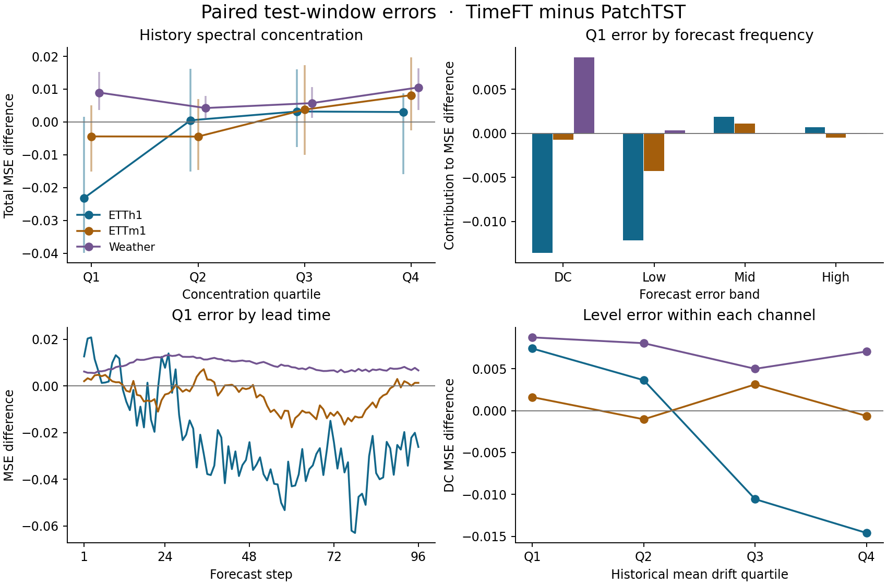

# TimeFT 的收益落在哪里？

以下差值均为 **TimeFT 减 PatchTST**，负值表示 TimeFT 误差更低。DC 误差是每个窗口、每个通道的 96 步平均预测误差的平方，因此能衡量水平偏离，不能据此断言模型总是高估或低估。

## ETT 的低集中度收益

沿用 Table 5 的分组。每个通道用 320 步历史的非 DC 谱计算功率最大的三个频点占比，再对通道等权平均。每个数据集按这个分数分四组，Q1 最分散。分组没有用到未来真值。低集中度描述谱能量分散，趋势、瞬态和多周期都可能产生这种结果。

| 测试集 | Q1 总 MSE 差 | Q2 | Q3 | Q4 | Q1−Q4 的 95% 时间块区间 |
|---|---:|---:|---:|---:|---:|
| ETTh1 | −0.02316 | +0.00051 | +0.00320 | +0.00303 | [−0.04399, −0.00056] |
| ETTm1 | −0.00440 | −0.00445 | +0.00376 | +0.00817 | [−0.02853, +0.00182] |
| Weather | +0.00896 | +0.00425 | +0.00575 | +0.01052 | [−0.01037, +0.00835] |

ETTh1 的 Q1 平均 MSE 从 0.54289 降到 0.51973。ETTm1 的 Q1 从 0.27071 降到 0.26631，Q2 改善略大于 Q1。两组 ETT 共同支持的是“低集中度半区表现较好”，其中 ETTh1 的四分位差异更明确。单独检验 Q1 的总改善，两组 ETT 的时间块区间均跨零。

把时间块由 416 加长到 832，ETTh1 的 Q1−Q4 总差区间上界从 −0.00056 变为 +0.00080，形状差区间仍全在零以下。低集中度收益的方向清楚，总 MSE 差的统计把握对块长敏感。



### 频率与预测步长

以下是对 **Q1 同一批窗口** 的两种切法。频段列是对整段 MSE 的可加贡献，使用 96 步预测残差的实数 FFT，DC / 低 / 中 / 高频分别是 0、1–4、5–12、13–48 号频点。低频对应 24–96 步周期。步长列是该段 24 步的平均差，四列的平均值等于总差；两个表不能相加。

| Q1 | DC | 低频 | 中频 | 高频 | 去均值形状 |
|---|---:|---:|---:|---:|---:|
| ETTh1 | −0.01358 | −0.01213 | +0.00185 | +0.00071 | −0.00958 |
| ETTm1 | −0.00075 | −0.00426 | +0.00109 | −0.00048 | −0.00365 |
| Weather | +0.00861 | +0.00037 | +0.00005 | −0.00006 | +0.00035 |

| Q1 | 第 1–24 步 | 第 25–48 步 | 第 49–72 步 | 第 73–96 步 |
|---|---:|---:|---:|---:|
| ETTh1 | +0.00141 | −0.02363 | −0.03567 | −0.03474 |
| ETTm1 | −0.00089 | +0.00003 | −0.01046 | −0.00628 |
| Weather | +0.00906 | +0.01176 | +0.00811 | +0.00692 |

ETTh1 的改进约 59% 来自预测平均水平，其余净收益来自形状。ETTm1 主要改善缓慢起伏。ETTh1 有 6/7 个通道在 Q1 改善，ETTm1 有 5/7 个，两者受益最大的两个通道都是 HUFL 与 MUFL。这里的低频误差涵盖整个频段，与原分析的主频幅值、相位指标衡量不同的量。

### 是预测更保守，还是形状更准确？

| Q1，PatchTST → TimeFT | 预测时间方差 | 相邻步差分均方 | 预测与真值的窗内相关 |
|---|---:|---:|---:|
| ETTh1 | 0.2062 → 0.1813 | 0.04061 → 0.02746 | 0.4955 → 0.5005 |
| ETTm1 | 0.2877 → 0.2455 | 0.00532 → 0.00319 | 0.6422 → 0.6469 |
| Weather | 0.02219 → 0.02099 | 0.000485 → 0.000194 | 0.4376 → 0.4310 |

方差和差分均方先在每个窗口的每个通道上计算，再等权平均。相关系数只比较两种预测与真值方差均足以计算相关的相同样本，覆盖两个 ETT 的全部 Q1 样本及 Weather 的 94.1%。ETT 两组的真值时间方差分别为 0.6805 和 0.5356，均明显高于两种预测。

形状 MSE 等于预测方差加真值方差再减去两倍协方差。比较模型时真值项抵消。ETTh1 的方差项贡献 −0.02497，协方差项抵消 +0.01540。ETTm1 对应 −0.04212 和 +0.03847。两种 ETT 的预测都更平滑，形状相关系数只提高约 0.005。这支持压低预测振幅的解释，但方差和协方差会一起随振幅变化，这个恒等式本身不能识别训练机制。

**直接平滑 PatchTST 的对照**。保留每条预测的平均值和相位，用 0 到 1 之间的固定系数衰减非 DC 频点。下表只比较形状 MSE，基线是未处理的 PatchTST。前两种系数直接用 Q1 真值最小化 MSE，是各自滤波器族在这一批窗口上能达到的最佳值。最后一列改为五个连续时间段轮流留出，用其余 Q1 窗口拟合逐频点系数，并在边界隔离 415 个起点，避免共享原始观测。它是诊断对照，拟合数据可含留出段后面的观测。

| Q1 | TimeFT 形状差 | 三频段×通道组内最优 | 逐频点×通道组内最优 | 逐频点×通道时间留出 |
|---|---:|---:|---:|---:|
| ETTh1 | −0.00958 | −0.00316 | −0.01516 | −0.00244 |
| ETTm1 | −0.00365 | −0.00066 | −0.00124 | +0.00014 |
| Weather | +0.00035 | −0.00092 | −0.00101 | −0.00063 |

ETTh1 上，事后为每个频点挑选衰减强度，确实足以解释形状改善的量级；移到隔开的时间段，只复现约四分之一。ETTm1 上，即便逐频点事后最优，也只复现约三分之一。模型显然更保守，固定滤波不能稳定复现它学到的全部变化。数据仍允许随输入调整振幅、改变相位或不同的训练拟合等解释，没有单独识别“学到复杂非周期特征”的因果效应。

### Weather 去掉 DC 后

四个集中度组的形状 MSE 差依次为 **+0.00035、+0.00052、−0.00024、+0.00001**。Q1−Q4 差为 +0.00035，时间块区间 [−0.00118, +0.00182]。Weather 同样输出更平滑，Q1 却没有 ETT 的形状改善。对预测平滑度的观察可在三组数据复现，平滑能否换来更低误差取决于数据。

## 哪些窗口容易出现水平误差？

### Weather 工程对照：清洗后从头训练

仅替换训练段 80 行中的 81 个占位值（风速 1 个、最大光合有效辐射 30 个、OT 50 个），在各列训练段内部线性插值，保留行数与时序。逐单元复核确认其余值和时间戳相同。两模型从头训练并重新拟合训练标准化器，保留 Table 5 代码、2021 种子、编码器初始化、分割、批次顺序、早停和 type1 学习率。PatchTST / TimeFT 分别在第 11 / 17 轮停止，恢复验证误差最低的第 6 / 12 轮。两次新训练使用同一 RTX 3090，旧基线使用 RTX 4090 D。

旧、新权重均在原 10,444 个测试起点评估。下表统一本次插值后训练集的标准差，逐通道换算，再等权汇总；同时核对每个起点、时间戳和逆标准化后的全部测试目标。

| 训练数据 | PatchTST DC MSE | TimeFT DC MSE | DC 差及 95% 时间块区间 | 总 MSE 差 |
|---|---:|---:|---:|---:|
| 原训练集，旧权重重评分 | 0.08958 | 0.09616 | +0.00657 [0.00381, 0.00969] | +0.00643 |
| 清洗训练集，新权重 | 0.08988 | 0.09521 | **+0.00533 [0.00275, 0.00816]** | +0.00435 |

清洗后 TimeFT 的 DC MSE 仍高 **5.9%**，去均值形状改善约 0.00098，抵消了部分水平损失。换回原 Table 5 尺度，新权重的 DC 差仍为 +0.00578。占位值确实影响权重和数值大小，不能充分解释水平劣势。前后差距的缩小是单种子、跨 GPU 的点估计。此处选择了题目中的清洗对照，温和 LR 对此差距的独立影响仍待单因素实验。

同一批起点上，清洗重训后的低到高集中度四组形状差为 −0.00046、−0.00030、−0.00162、−0.00154。Q1−Q4 为 +0.00108，区间 [−0.00081, +0.00292]。Q1 虽有小幅形状改善，更集中窗口的改善更大。按通道内历史漂移分组，四组 DC 差则为 +0.00501、+0.00729、+0.00523、+0.00379，强漂移组仍没有最大水平损失。

### 三套数据的原配对预测

把相邻两个 160 步历史窗口的均值之差取绝对值，单位为该通道的训练集标准差。这个分数衡量已经观察到的水平变化，也是强趋势的一种代理。它不使用预测期的均值。分别做两个分组，区分“哪类通道”和“同一通道的哪个时段”。

| 数据集 | 通道内低漂移 Q1 | Q2 | Q3 | 高漂移 Q4 | Q4−Q1 的 95% 时间块区间 |
|---|---:|---:|---:|---:|---:|
| ETTh1 | +0.00741 | +0.00363 | −0.01057 | −0.01460 | [−0.03764, −0.00759] |
| ETTm1 | +0.00161 | −0.00104 | +0.00313 | −0.00064 | [−0.01089, +0.00504] |
| Weather | +0.00874 | +0.00805 | +0.00499 | +0.00706 | [−0.00922, +0.00542] |

表中是每个通道单独按漂移排序、再汇总所得的 DC MSE 差。ETTh1 的七个通道全部呈现 Q4 优于 Q1；Weather 的四组都有平均水平劣势，最大劣势出现在低漂移组。因而用“遇到强漂移就预期 TimeFT 更差”来选择模型，甚至会在 ETTh1 上指向相反方向。

以各组 PatchTST 的 DC MSE 为分母，ETTh1 的相对差从低漂移组的 +12.2% 变为高漂移组的 −21.8%，ETTm1 从 +2.3% 变为 −0.6%，Weather 从 +19.9% 变为 +8.9%。这排除了“只因高漂移组基线误差较大，绝对差才呈现上述方向”的简单解释。

另一种做法是按每个通道的平均漂移将**通道**分四组。Weather 的四组 DC 差依次为 −0.00021、+0.00313、+0.00994、+0.01746，ETTh1 为 −0.00244、−0.00260、−0.00481、−0.00501，ETTm1 为 −0.00055、+0.00109、+0.00389、−0.00348。Weather 的跨通道关联存在，但物理量、训练标准差及目标噪声也随通道而变。每组 ETT 仅 1–2 个通道。跨通道均值不能替代同一通道的时段比较。

将漂移指标换成 320 步历史拟合直线的首尾高度差绝对值后，ETTh1 / ETTm1 / Weather 的最强趋势组 DC 差分别为 −0.01615 / −0.00080 / +0.00673。Weather 的最弱趋势组为 +0.01086。测量趋势的两种方式给出相同的反例。

## 复核与适用范围

复用 Table 5 全部测试起点，ETTh1 / ETTm1 / Weather 分别为 2,785 / 11,425 / 10,444 个。脚本复核六个总体 MSE、每组两模型的四分位 MSE、每窗频段贡献之和及方差协方差恒等式。区间为固定训练权重下的配对循环移动块 bootstrap，块长 416 个连续起点（输入 320 加预测 96），2,000 次。分组固定，每次共同抽取两种模型和全部通道。这些是描述时间段不确定性的近似区间，ETTh1 尤其只有约七块，并未覆盖训练种子、跨站点或多重比较不确定性。此处使用原测试段，已完成的跨年和分词反例均未重跑。

在仓库根目录执行 `python -m reproduction.attribution.analyze` 可重建三个数据集子目录中的表。`concentration.csv` 含四分位的预测、真值及分解指标；`horizon.csv` 给出每一步；`q1_channels.csv` 和 `drift.csv` 给出通道明细；`intervals.csv` 保存配对区间。

清洗重训及复核命令如下。配对配置、逐轮记录和验证集选择结果见 [训练证据](Weather/training)，两种统一尺度的完整对照见 [水平与总误差](Weather/control.csv)、[漂移分组](Weather/control_drift.csv) 和 [去均值形状](Weather/control_shape.csv)。本地结果目录保留了两套清洗重训权重、预测和真值。下载包的 SHA-256 为 `b14ba61733d790677b94e4e66df9e877949e4d1f491e9374320150ad43aabb16`。

```bash
python -m reproduction.attribution.clean_weather dataset/weather/weather.csv results/attribution/data/weather/weather.csv
for variant in patch timeft; do
  python -m reproduction.table5.train --dataset Weather --variant "$variant" --data-dir results/attribution/data --output results/attribution/clean
done
python -m reproduction.attribution.compare_weather results/table5/formal/Weather results/attribution/clean/formal/Weather reproduction/attribution/report/Weather
python -m reproduction.attribution.plot
```
