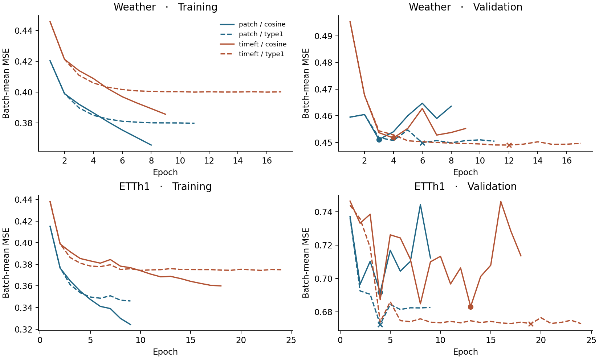

# 学习率能解释 TimeFT 的水平误差和平滑度吗？

**清洗后 Weather 给出两个不同的答案。** 换成 cosine，两种模型相邻预测步的变化幅度几乎一样，TimeFT 的窗内方差甚至更大。预测过于平滑对优化设置很敏感。与此同时，TimeFT 对未来 96 步平均水平的误差仍然更大。cosine 缩小了一部分水平差距，也丢失了原有的形状优势，最终总体 MSE 差几乎没变。

## 对照与总体误差

只新增四次训练，复用清洗后 Weather 的两份 type1 权重和 Table 5 的两份 ETTh1 权重。下文每个模型差均取 TimeFT 减 PatchTST，正值表示 TimeFT 的误差更大。DC MSE 先求每个通道 96 步预测的平均偏差，再平方；形状 MSE 将预测和真值分别去均值后计算。两项相加等于总 MSE。

| 数据集 | 调度 | PatchTST 总 MSE | TimeFT 总 MSE | 总差 | DC 差 [95% 时间块区间] | 形状差 |
|---|---|---:|---:|---:|---:|---:|
| 清洗 Weather | type1 | 0.19924 | 0.20359 | +0.00435 | +0.00533 [+0.00275, +0.00816] | -0.00098 |
| 清洗 Weather | cosine | 0.19933 | 0.20356 | +0.00424 | +0.00349 [+0.00108, +0.00615] | +0.00075 |
| ETTh1 | type1 | 0.38212 | 0.37801 | -0.00411 | -0.00353 [-0.00989, +0.00196] | -0.00058 |
| ETTh1 | cosine | 0.39171 | 0.39008 | -0.00162 | -0.00600 [-0.01531, +0.00228] | +0.00438 |

Weather 的 DC 差从 +0.00533 降至 +0.00349，点估计缩小 34.6%。PatchTST 自身 DC MSE 从 0.08988 到 0.08992，TimeFT 从 0.09521 到 0.09340。四套预测按起点配对后，**差距变化为 −0.00184，95% 区间 [−0.00376, +0.00017]**。有把握的是 cosine 下仍有 DC 劣势；这次缩小的幅度还有时段不确定性。形状差向不利方向移动 +0.00173 [+0.00115, +0.00246]。二者抵消后，总 MSE 差只变了 −0.00011 [−0.00226, +0.00230]。

ETTh1 的两模型在 cosine 下绝对测试 MSE 均上升。最低历史谱集中度组 Q1 中，TimeFT 的相对总收益从 0.02316 增至 0.02902，cosine 的配对 MSE 差为 −0.02902 [−0.03993, −0.01017]。其 DC 和形状分别贡献 −0.02179 和 −0.00722。两种模型在 Q1 的绝对 MSE 都比原来更高，PatchTST 恶化得更多。Weather 的 Q1 没有表现出这个收益，cosine 总差为 +0.00579，DC 差 +0.00494，形状差 +0.00085。

## 平滑度与窗内相关

每格依次为 **PatchTST → TimeFT**。时间方差衡量整段预测的起伏大小，相邻步差分均方衡量一步到下一步变化有多快。相关系数描述预测和真实曲线的起伏方向是否一致。三项都是先按窗口、通道计算，再平均。

| 数据集 | 窗口 | 调度 | 时间方差 | 相邻步差分均方 | 窗内相关 |
|---|---|---|---:|---:|---:|
| Weather | all | type1 | 0.02673 → 0.02480 | 0.0006498 → 0.0002188 | 0.4454 → 0.4533 |
| Weather | all | cosine | 0.02990 → 0.03331 | 0.0010780 → 0.0010704 | 0.4413 → 0.4421 |
| Weather | Q1 | type1 | 0.02910 → 0.02745 | 0.0006560 → 0.0002123 | 0.4455 → 0.4399 |
| Weather | Q1 | cosine | 0.03187 → 0.03656 | 0.0010359 → 0.0009734 | 0.4342 → 0.4321 |
| ETTh1 | all | type1 | 0.31239 → 0.28013 | 0.0546776 → 0.0404047 | 0.5791 → 0.5846 |
| ETTh1 | all | cosine | 0.32069 → 0.31941 | 0.0593904 → 0.0564572 | 0.5679 → 0.5654 |
| ETTh1 | Q1 | type1 | 0.20625 → 0.18127 | 0.0406102 → 0.0274630 | 0.4955 → 0.5005 |
| ETTh1 | Q1 | cosine | 0.22094 → 0.21151 | 0.0457931 → 0.0404609 | 0.4779 → 0.4856 |

Weather 全体的相邻步差分均方，TimeFT 从比 PatchTST 低 66.3% 变为仅低 0.7%；cosine 的绝对差为 −0.0000076 [−0.0000526, +0.0000400]（精确数见明细）。时间方差从低 7.2% 变成高 11.4%。Q1 的差分均方差也大幅收窄。两种模型预测的粗糙度都低于实际观测，真实 Weather 全体相邻步差分均方为 0.04391；上述判断是同一预测任务中两种模型的比较。

ETTh1 全体的时间方差在 cosine 下接近，相邻步差分均方仍低约 4.9%。Q1 中，该指标从低 32.4% 变为低 11.6%。ETTh1 的平滑差距缩小后，Q1 的平均水平收益仍在。

## 训练和验证如何收敛

每格的三个损失值依次给出第 1 轮、验证最优轮、停止轮。模型评价一律使用最优轮权重。训练与验证损失都沿用 Table 5 对批次 MSE 取平均的记法。

| 数据集 | 模型 | 调度 | 最优 / 停止轮 | 最优轮实际 LR | 训练损失（初 → 优 → 停） | 验证损失（初 → 优 → 停） |
|---|---|---|---:|---:|---:|---:|
| Weather | patch | type1 | 6 / 11 | 3.13e-06 | 0.42043 → 0.38115 → 0.37984 | 0.45952 → 0.44988 → 0.45050 |
| Weather | patch | cosine | 3 / 8 | 4.99e-05 | 0.42043 → 0.39218 → 0.36573 | 0.45952 → 0.45114 → 0.46360 |
| Weather | timeft | type1 | 12 / 17 | 4.88e-08 | 0.44578 → 0.40027 → 0.40023 | 0.49529 → 0.44907 → 0.44968 |
| Weather | timeft | cosine | 4 / 9 | 4.98e-05 | 0.44578 → 0.40887 → 0.38565 | 0.49529 → 0.45172 → 0.45526 |
| ETTh1 | patch | type1 | 4 / 9 | 1.25e-05 | 0.41553 → 0.35367 → 0.34603 | 0.73638 → 0.67239 → 0.68262 |
| ETTh1 | patch | cosine | 4 / 9 | 4.98e-05 | 0.41520 → 0.35517 → 0.32424 | 0.73710 → 0.69169 → 0.71228 |
| ETTh1 | timeft | type1 | 19 / 24 | 3.81e-10 | 0.43853 → 0.37448 → 0.37499 | 0.74396 → 0.67288 → 0.67291 |
| ETTh1 | timeft | cosine | 13 / 18 | 4.65e-05 | 0.43798 → 0.36883 → 0.35999 | 0.74643 → 0.68313 → 0.71365 |



Weather TimeFT 在 cosine 下确实能继续降低训练损失，但其验证损失在第 4 轮见底，到第 9 轮连续五轮未刷新最低值。cosine 的最优验证损失 0.45172 略高于 type1 的 0.44907。维持较大学习率改变了拟合过程，也消除了大部分相对平滑，但没有带来“多训练几轮就能在未见样本上追上平均水平”的结果。最佳轮和早停轮是调度通过原有模型选择规则产生的结果。

## 判别结论与实验边界

1. **优化因素能解释大部分相对平滑。** 保持模型代码、数据及早停规则相同，Weather 的粗糙度差距几乎消失，方差差距反向。ETTh1 的平滑差距也缩小。
2. **快速衰减不足以解释 Weather 的 DC 劣势。** cosine 下剩余差距约为 PatchTST 自身 DC MSE 的 3.9%，时间块区间仍全在零以上。残差与当前 TimeFT 架构在此数据上的归纳偏置相容。两种模型既有分词差异，也有对应投影、token 数和预测头宽度的差异，单次调度干预不能把剩余损失唯一定位到分词算子。
3. **泛化范围限于当前种子和早停协议。** Weather 两个调度均用 RTX 3090；两模型各自第 1 轮训练和验证损失跨调度一致。ETTh1 的旧设备为 RTX 4090 D，新设备为 RTX 3090，第 1 轮已有微小数值差异。ETTh1 可作跨数据集参照，对细小的调度差值须保留硬件限制。

## 复核和复现

种子 2021，Adam 初始 LR 5e−5，上限 70 轮，patience=5。沿用仓库的 cosine，训练第 e 轮实际使用 5e−5 × (1 + cos(π(e−1)/70)) / 2，没有额外设置学习率下限。原 type1 在第 10 轮实际使用 1.953125e−7，cosine 曲线该轮约 4.80e−5；两次 Weather cosine 训练均提前结束。配置核对覆盖模型、初始化种子与编码器初始哈希、数据哈希、切分、批量与精度设置。相同训练入口与生成器种子决定了对应模型的数据批次顺序。已逐项核对两种调度的测试起点、时间戳、真值、通道顺序、缩放参数，以及每轮实际使用的学习率。

全体包含 Weather 10,444 个、ETTh1 2,785 个测试起点。Q1 沿用归因实验的非 DC 前三个频点能量占比，按历史窗口排序取最低四分位，分别为 2,611 和 697 个起点，成员逐个核对一致。窗内相关在四套预测和真值都可计算的同一组窗口通道上取均值，Weather 全体/Q1 覆盖 93.49%/94.06%，ETTh1 均为 100%。置信区间使用 2,000 次循环移动时间块 bootstrap，每块 416 个相邻起点。四套模型与全部通道同步抽样，Q1 在每次抽样中保留原分组。这些区间描述固定权重下的测试时段不确定性。

[逐模型指标](metrics.csv) · [各项差值和配对区间](contrasts.csv) · [训练摘要](training.csv) · [逐轮训练与学习率](epochs.csv) · [初始化与数据核验](verification.json) · [四份 cosine 原始日志与配置](evidence/)

在仓库根目录、已准备好前序基线及清洗数据时执行以下命令。四次 cosine 已完成，直接运行后两条即可从本地保留的预测重建表和图。

```bash
bash reproduction/lr_schedule/run.sh
python -m reproduction.lr_schedule.analyze
python -m reproduction.lr_schedule.plot
```
