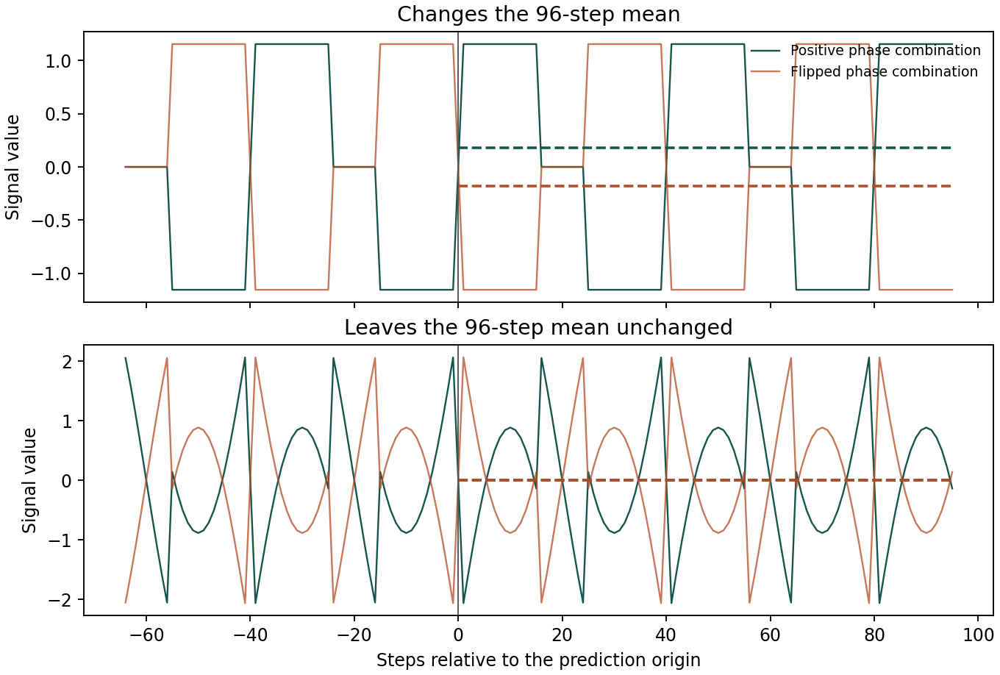
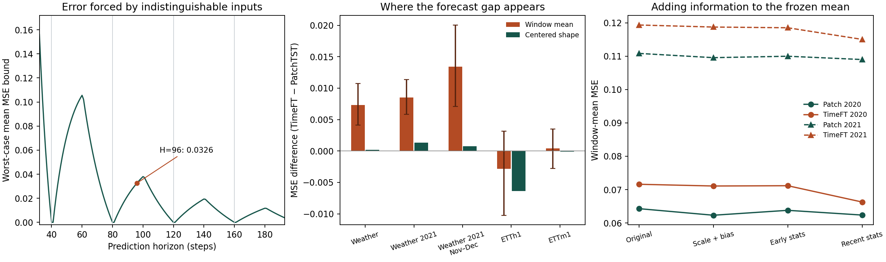
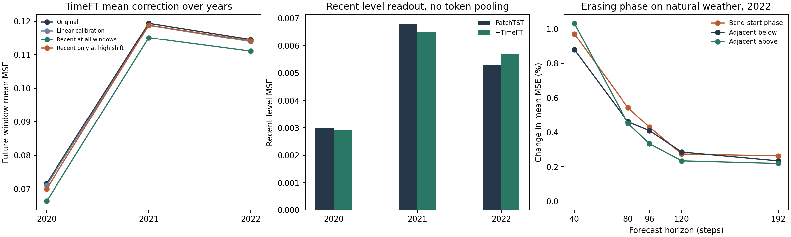

# TimeFT 的频域盲区与预报均值

**最有潜力的论文结论是，分词器丢失同样多的输入信息，对不同预测目标和预测长度可以有完全不同的代价。** 本实验给出精确的相位反例与均值误差下界。在真实 Weather 上，2021 和 2022 都复现了 TimeFT 的均值预测劣势。真实差距并不能由该相位盲区的线性擦除实验解释，且原先设想的高偏移修正规则未在独立年份得到支持。

## 研究问题

TimeFT 在 Weather 的均值预测中为什么落后？可能的解释包括频带边界确实丢失了信号、近期变化虽然存在却未被原预测头充分利用、时段变化带来分布差异，以及原基准的缺测处理改变了评分权重。实验将这些解释分别检验。主要度量是未来 96 步的均值 MSE。对齐每个预测窗的均值后，剩余的是波形 MSE，二者严格相加等于总 MSE。

## 数据、模型与分析隔离

复用 Table 5 种子 2021 的六个 checkpoint，单张 RTX 3090 只做冻结推理、信号干预与线性读出。输入长度 320 步，主实验预测 96 步。原 Weather 跨 2020 年。2020 原测试段已用于发现问题，本次用于诊断。Weather 2021 和 2022 取自同一座 Beutenberg 屋顶测站，分别用于第一轮独立跨年检验与第二轮锁定检验。将 2020 上半年原站与基准对齐，**26,198 个时刻、21 个变量逐项一致**，并确认基准的 `OT` 对应 `CO2 (ppm)`。跨年输入统一使用 2020 原训练段的尺度，排除含占位缺测或时间断点的窗口。 [Max Planck 屋顶站数据与 CC BY 4.0](https://www.bgc-jena.mpg.de/wetter/weather_data.html)

所有岭回归读出在 2020 原训练段拟合，原验证段选正则。均值校准仅用 2020 原验证期的两个时序段，两段之间留 415 个起点单位的间隔，排除输入或标签时间重叠。两个外部年份均不用于拟合。独立年份约每小时取一个预测起点，置信区间按 7 天连续块做配对重采样。区间描述固定 checkpoint 的时间变动，不估计随机种子不确定性。原来的 RTX 4090 D 和此次 RTX 3090 对 32 个参考窗口的预测差异 RMS 均小于 0.00016。 [主验证方案](../PLAN.md) · [2022 锁定协议](../FOLLOWUP.md)

## 结构性结果 · 相同的历史重建误差，可能对应完全不同的预测风险

### 可直接验证的盲区

公开实现对长度 320 的历史取 RFFT，每 8 个频点切一个子带，把每个子带起点直接移到其零频位置，再做 IRFFT。原频点 $k=8,16,\ldots,152$ 的正弦分量因此被丢弃。零频只允许实部，正弦系数恰好对应原频点的虚部。论文附录 C.4 已描述这处损失。本实验进一步证明在保持历史均值、方差相同的条件下，处于盲区中的两条历史可以产生不同的未来目标。 [TimeFT v2 附录 C.4](https://arxiv.org/html/2610.28997v2) · [分词实现](../../table5/model.py#L15)

把历史写成可见部分 $u$ 加上待检验的正弦组合 $v$。取 $u$ 与 $v$ 正交，且 $v$ 均值为零。则 $u+v$ 和 $u-v$ 的历史均值与方差相同，归一化与反归一化也不会区分二者。若 $v$ 只含以上 19 个正弦模式，原始 TimeFT token 在精确算术下相同。实际 checkpoint 对 64 个真实 Weather 窗口翻转所有这些系数的符号，输入变化 RMS 为 0.1236。TimeFT 的预测均值变化 RMS 约 **0.000011**，PatchTST 约 **0.0616**。TimeFT 对相邻两组频点的响应约为 **0.0448**。实数算法中的同一性在运行时受到浮点舍入影响。 [干预逐项结果](analysis/interventions.csv) · [实测翻转记录](evidence/remote/Weather/timeft_audit.json)

### 有限预测窗改变了丢失信息的代价

在「观测到的正弦信号继续按原周期运行」的受控实验里，令预测窗长为 $H$，$r=H\bmod40$。所有被丢掉的模式都是 40 步周期内的正弦基。对盲区中单位 RMS 的扰动，给两条同 token 历史各一半概率。只见到这些 token 的模型，最坏配对上的未来均值 MSE 下界为 $B(H)$。

$$
B(H)=\frac{40}{2H^2}\min\bigl(\max(r-1,0),\,40-r\bigr).
$$

推导分三步。第一，所有盲区分量在 40 步整数周期上的和为零，只需算余下的 $r$ 步。第二，把余数窗的指示向量投到关于 $t\mapsto -t\pmod{40}$ 的奇对称子空间。每对只出现一侧的位置贡献两个绝对值为 $1/2$ 的元素，共有 $\min(\max(r-1,0),40-r)$ 对。以单位历史 RMS 作为振幅约束，通过内积最大化得到上式。第三，若两条未来均值为 $m+\delta$ 和 $m-\delta$，同一个预测在这对样本上的最小平均平方误差为 $\delta^2$。以与余数窗投影对齐的正弦组合作为扰动即可达到界。

| 预测长度 (H) | 40 | 80 | 96 | 120 | 192 | 336 | 720 |
|---|---:|---:|---:|---:|---:|---:|---:|
| 最坏配对的均值 MSE 下界 | 0 | 0 | 0.032552 | 0 | 0.004340 | 0.002657 | 0 |

在同样的 $H=96$ 下，构造两个输入重建误差完全一样的单位 RMS 盲区分量。第一个与未来求均值的方向对齐，产生 0.032552 的下界。第二个和该方向正交，沿该扰动的未来均值歧义为零。对这个周期延拓任务，只把丢失分量沿未来均值方向的**一个标量投影**补给预测器，便能完全消掉这项歧义。该证明的目标是周期延拓信号的均值。真实天气与逐点预测需要单独的证据。 [720 个预测长度的数值验证](analysis/phase_bound.csv) · [等能量反例](analysis/blind_witnesses.npz)



## 真实数据 · 盲区、可读性和最终预测是不同环节

原 Weather 2020 测试段每小时抽取一个起点，TimeFT 的均值 MSE 比 PatchTST 高 **0.00732**。2021 年全年 **8,316** 个合格窗口，差距为 **0.00852**，按周配对重采样的 95% 区间约为 **[0.00582, 0.01139]**。2021 的 12 个月均为 TimeFT 均值误差较高，11–12 月的平均差为 **0.01343**。2021 年高近期偏移组的差距为 **0.02167**，其余为 **0.00525**。这一条件用历史数据就能确定。在 ETTh1 上原始均值误差方向相反，ETTm1 差距很小。 [均值与波形精确拆分](analysis/baseline.csv) · [逐月结果](analysis/monthly.csv)

在 2021 年自然数据上，从原始历史训练同类线性模型，完整输入未来均值 MSE 为 **0.13825**。擦除真正的带边界正弦后是 **0.13854**，擦除数量相同的下侧相邻正弦后是 **0.13870**，擦上侧相邻正弦后是 **0.13842**。2020 上也有相同的相对顺序。带边界丢失真实存在，但目前未见它比邻频删减更能解释自然数据上的 Weather 大幅差距。读出方法不同，不能把这个差值当成深度模型误差的因果占比。 [同维度擦除对照](analysis/raw_probe.csv)

在第一种四组池化读出中，Weather 2021 冻结 TimeFT 编码器的近期均值 MSE 是 **0.00621**，PatchTST 是 **0.03504**。只用同容量读出预测未来均值，TimeFT 也从原预测头上的落后，变为读出下的 **0.11770 对 0.12145**。对近段统计量可读性的观察强于对未来目标的排序。2021 年 11–12 月，未来均值读出的排序就与全年相反。这个结果反驳了最简单的「近期信息已经从 TimeFT 表示消失」解释。原预测头的拓扑、训练目标、有限训练和读出方式仍有待进一步区分。 [各层读出](analysis/frozen_probe.csv)



## 追加验证 · 2022 年、两种读出与两种修正规则

2022 原站档案去掉 7 条重复记录，10 分钟网格缺 82 条，512 条有缺测占位值。只用完整且时间连续的历史与未来，剩 **7,543** 个合格预测起点。2022 的规则和模型均由 2020 固定。两种方法使用相同的可用窗口。 [2022 输入记录](evidence/prepared_2022/input2022.json)

| Weather 评估期 | 有效窗口 | PatchTST 原均值 MSE | TimeFT 原均值 MSE | TimeFT 减 PatchTST，按周重采样区间 |
|---|---:|---:|---:|---|
| 2020 原测试段 | 1,741 | 0.06428 | 0.07160 | +0.00732 [0.00414, 0.01072] |
| 2021 全年 | 8,316 | 0.11084 | 0.11936 | +0.00852 [0.00582, 0.01139] |
| 2022 全年 | 7,543 | 0.10616 | 0.11453 | +0.00837 [0.00589, 0.01078] |

2022 高偏移组的原均值差距为 **0.01618**，其余为 **0.00624**。2021 和 2022 的均值差距分别占总 MSE 增量约 **86%**，因此跨年仍以水平估计为主。实际增量规模来自同一测站和固定的两个模型。 [跨年误差表](analysis/locked_gate.csv) · [配对周块区间](analysis/followup_effects.json)

**读出结构能改变对表示的判断。** 第一轮的池化读出让 TimeFT 有明显的近期均值优势。第二轮按原 token 次序拼接，不做池化，近期均值的误差接近。在 2021 年，PatchTST 为 **0.00680**、TimeFT 为 **0.00650**。2022 年分别为 **0.00527**、**0.00570**。这个结果说明近期信息在两种表示中均可读出，并表明先前观察到的优势依赖读出方式。未来均值排序也随读出改变。固定结构的线性探针无法单独确定原预测头的优化是差距主因。 [按 token 次序的读出](analysis/unpooled_probe.csv)

**误差大的窗口和修正最有效的窗口发生了错位。** 始终提供近期统计量，相对仅线性校准，TimeFT 的均值 MSE 在 2021、2022 分别改善 **0.00370**、**0.00287**。其改善比 PatchTST 多 **0.00314**、**0.00260**。2022 的高偏移组，TimeFT 在加入近期统计量以后，均值 MSE 反而多了约 **0.00128**，周块区间跨过零。其余窗口改善 **0.00400**，区间为 **[0.00257, 0.00531]**。只在高偏移时启用修正的全年效果为 **−0.00027**（正值才表示改善），与零相容。始终修正缩小了模型差距，但在两个外部年份中 TimeFT 的总 MSE 仍高于采用同样修正的 PatchTST。

**真实天气并不遵循合成信号整周期抵消的条件。** 对每个自然窗保持相同历史，比较 40、80、96、120、192 步的未来均值。以 2022 为例，在理论周期反例中均值风险为零的 40 步目标上，擦除带边界后，自然数据线性读出的 MSE 仍上升 **0.97%**，两组相邻对照为 **0.88%** 和 **1.03%**。96 步的三个变化约为 **0.43%、0.41%、0.33%**。这个控制验证了理论条件的边界，也给出了实际误差量级。 [固定窗口的跨预测长度对照](analysis/natural_horizons.csv)



## 数据审计 · 缺测占位值会改变标准化后的权重

Weather 原训练段有 80 行含 `−9999` 一类的缺测占位值，验证段与测试相关窗口没有这类占位值。单个风速占位值使该通道的训练标准差约为剔除缺测后 **31.25 倍**。二氧化碳为 **21.12 倍**。按剔除占位值后的尺度重评分，同一批旧预测的均值 MSE 为 PatchTST **0.08967**、TimeFT **0.09624**，TimeFT 仍然较差。评分尺度解释不了方向。训练时的损失权重和输入异常也会受到影响，需要清洗后重新训练才能量化。 [占位值与重新评分审计](weather_sentinel_audit.json)

## 可以发展的论文主线

**分词失真是否重要，取决于分词丢掉的方向是否与预测任务对齐。** 同样的历史重建误差，可以产生显著不同的预测均值风险。对线性输入表示 $T$ 和线性目标 $q$，从 token 完全恢复该目标的条件是 $\ker(T)\subseteq\ker(q)$，即表示无法区分的输入变化也不改变目标。周期延拓的均值实验给了一个可证明且可操作的例子。自然数据中还需要判断这些方向能否预测真实未来，以及学习的预测头是否利用了已经保留的线索。

这个区分也可以用平方损失表达。设 $Y$ 是实际未来窗的均值，$X$ 是历史，$Z$ 是模型得到的表示。表示导致的最优风险增量为

$$
\mathbb E\!\left[\bigl(\mathbb E[Y\mid X]-\mathbb E[Y\mid Z]\bigr)^2\right].
$$

这是全历史最优预测与固定表示最优预测之间的差距。已训练预测头相对于固定表示最优预测还会产生另一项误差。有限容量的探针仅能测到特定读出下的表现。实验结果分别为这两项提供了证据，但没有把真实误差精确归因到其中一项。

从这个主线出发，可以提出一个预测目标导向的分词审核协议。先找出原始分词可证的盲区，再用匹配频率的干预、两种读出和独立时间样本判断它是否影响指定预测目标。周期模型可以直接推导最小补充信息。在真实任务上，可以把**与预测目标对齐的一个标量**与**同成本但对目标正交的标量**做对照，同时保留普通近期统计量基线。实测高偏移修正规则的失败说明，直接按「哪里误差大」选择新增信息的使用时机缺少依据。后续应测试哪类输入在验证集上确实有条件收益，并用全新时段检验。

已发表工作涉及输入与预测区间统计量差异、按切片预测统计量、频域归一化与时频均值分支。最近也有研究用线性探针研究不同分词下各层的作用。因而「分开预测均值」或「加一个近期分支」很难单独作为新颖性主张。本轮最清楚的候选是**有限预测窗决定特定分词零空间对目标的危害**，以及**用独立的干预和读出来区分严格信息丢失、实际可读性与预测头的利用**。已有任务导向压缩研究也讨论了目标相关信息；论文主张应落在本实现和预测函数的具体结果上。 [Dish-TS](https://arxiv.org/abs/2302.14829) · [SAN](https://openreview.net/attachment?id=5BqDSw8r5j&name=pdf) · [FAN](https://arxiv.org/abs/2409.20371) · [TimeAPN](https://arxiv.org/abs/2603.17436) · [时序分词与组件探针](https://arxiv.org/abs/2611.31730) · [任务导向压缩](https://arxiv.org/abs/2405.04144)

## 证据与复算

仓库保留[机制验证源码](..)、[分析表格与图](analysis)、[第一轮日志](evidence/remote/run-log.txt)、[第二轮日志](evidence/remote_followup/run-log.txt)和[校验汇总](verification.json)。数据集版本、模型权重哈希与原站档案下载地址见[原始与 2021 输入记录](evidence/prepared/inputs.json)和[2022 输入记录](evidence/prepared_2022/input2022.json)。[第一轮](evidence/remote/files.sha256)和[第二轮](evidence/remote_followup/files.sha256)的产物清单含本地原始数组的哈希。

原始预测、真实序列和中间数组保存在本地项目的 `results/mechanism/remote` 与 `results/mechanism/remote_followup`。从项目根目录用下面两条命令复算分析结果。

```bash
python -m reproduction.mechanism.summarize results/mechanism/remote results/mechanism/analysis
python -m reproduction.mechanism.summarize_followup results/mechanism/remote results/mechanism/remote_followup results/mechanism/analysis
```

重新执行冻结推理需要 [Table 5 配对实验](../../table5/report/REPORT.md)生成的 `results/table5/formal` 和两份输入记录列出的数据。原站 ZIP 文件放入 `dataset/mechanism/weather-mpi`。在准备好匹配的 CUDA PyTorch 环境后，从项目根目录运行。

```bash
python -m reproduction.mechanism.prepare results/mechanism/prepared
python -m reproduction.mechanism.prepare_2022 results/mechanism/prepared_2022
python -m reproduction.mechanism.study --inputs results/mechanism/prepared --checkpoints results/table5/formal --output results/mechanism/remote
python -m reproduction.mechanism.followup --inputs results/mechanism/prepared --checkpoints results/table5/formal --primary results/mechanism/remote --external results/mechanism/prepared_2022/Weather2022.npz --output results/mechanism/remote_followup
```
