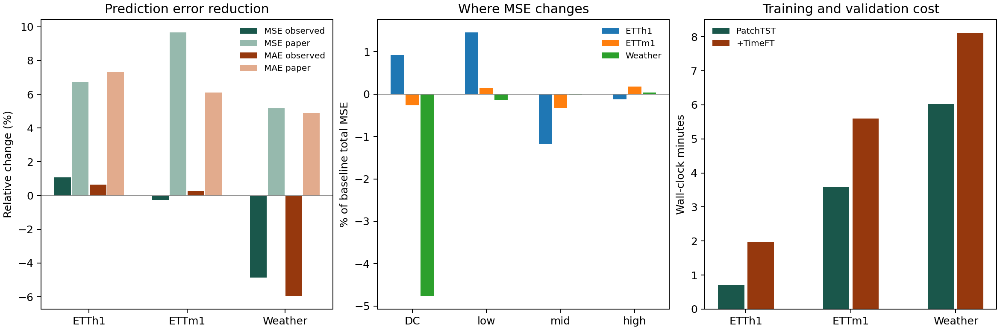
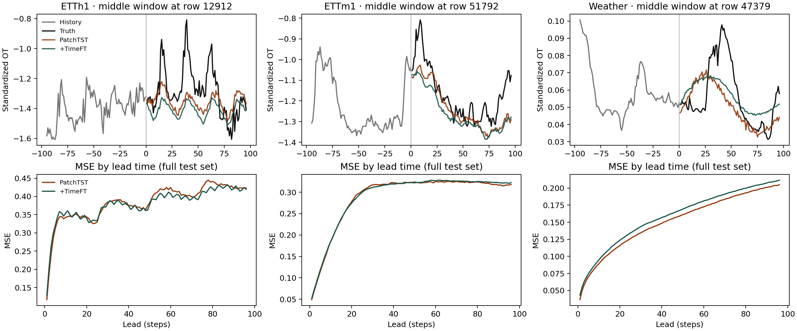
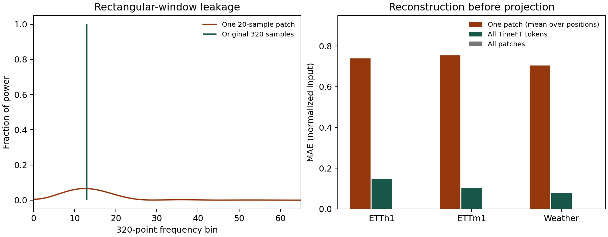

# TimeFT v2 Table 5 核心复现

六次正式训练均完成。ETTh1 的 MSE 和 MAE 同向改善，幅度低于论文。ETTm1 的两项误差朝相反方向小幅变化，Weather 的两项误差都上升。三个数据集的 PatchTST 基线均优于论文对应基线，ETTh1 和 ETTm1 的 TimeFT 绝对 MSE 仍与论文接近。

## Table 5 对照结果

| 数据集 | 论文 PatchTST MSE / MAE | 论文 +TimeFT MSE / MAE | 本次 PatchTST MSE / MAE | 本次 +TimeFT MSE / MAE | 论文降幅 MSE / MAE | 本次降幅 MSE / MAE |
|---|---|---|---|---|---|---|
| ETTh1 | 0.403 / 0.423 | 0.376 / 0.392 | 0.3821 / 0.4048 | 0.3780 / 0.4022 | +6.7% / +7.3% | **+1.08% / +0.64%** |
| ETTm1 | 0.321 / 0.361 | 0.290 / 0.339 | 0.2900 / 0.3443 | 0.2907 / 0.3433 | +9.7% / +6.1% | **−0.27% / +0.27%** |
| Weather | 0.155 / 0.204 | 0.147 / 0.194 | 0.1513 / 0.1998 | 0.1587 / 0.2117 | +5.2% / +4.9% | **−4.87% / −5.95%** |

降幅为 `(PatchTST − TimeFT) / PatchTST`，负值表示误差上升。论文百分数照录 Table 5。实测使用未四舍五入的原始 MSE 和 MAE。完整精度与绝对差见 [table5.csv](analysis/table5.csv)。 [论文 Table 5](https://arxiv.org/html/2610.28997v2#S4.T5)

ETTh1 和 ETTm1 的 TimeFT MSE 与论文相差 +0.0020 和 +0.0007，PatchTST 基线 MSE 分别比论文低 0.0209 和 0.0310。两组数值说明，基线起点的差异占了相对收益差异的大部分。Weather 的 TimeFT MSE 比论文高 0.0117，基线也比论文低 0.0037，两边的差异共同改变了收益方向。作者的逐组搜索配置未公开，本次固定的 patch/stride、位置编码策略、训练调度和单种子都可能影响比较。尤其是 `type1` 学习率到第 10 个 epoch 已降至 `1.95e-7`，这一设定会弱化后期继续优化的幅度。实验未单独操纵这些因素，无法据此判定哪一项是主因。

## 实验口径

使用固定种子 2021，在 ETTh1、ETTm1、Weather 上比较 PatchTST 与 PatchTST + TimeFT。输入 320 步，预测 96 步，预测所有通道。ETT 使用公开加载器的固定时间切分，Weather 按 70/10/20 切分。标准化只拟合训练段，MSE 与 MAE 按标准化尺度的全部测试窗口、步长与通道汇总。

公开 v2 附录 D.8 说明作者分别调整过两组超参数。作者仓库公布了 ETTm1 的 TimeFT 320→96 单组脚本。本实验将该脚本的配置推广到三个数据集和两种模型，冻结同一配置，无额外搜索。它回答的是固定配置下替换分词器的效果，也给出了与 Table 5 的数值差异。两组初始编码器 SHA-256 相同。两组都使用 TSLib 的位置编码策略，公开 TimeFT 文件默认跳过该项。TimeFT 保留其原有线性投影和偏置，也保留实际的 20 个 token。PatchTST 有 17 个 token，预测头宽度随 token 数变化。总参数与耗时差异包含这些结构后果。 [TimeFT v2](https://arxiv.org/html/2610.28997v2) · [作者仓库快照](https://github.com/ME1682/TimeFT/tree/50310ca2ba359fc15c4434793e6d25a0eb6704ac) · [TSLib PatchTST](https://github.com/thuml/Time-Series-Library/blob/4e938a1767106324dd753b2a44832bf870a0252e/models/PatchTST.py)

优化器为 Adam，批大小 32，初始 LR 为 `5e-5`，按公开代码的 `type1` 计划衰减，最多 70 个 epoch，patience 为 5。沿用公开实现的逐批验证 MSE 均值与 early stopping，以验证损失挑选 checkpoint。训练期间不查看测试损失。远端单张 RTX 4090 D 24 GB，Python 3.12.3、PyTorch 2.8.0+cu128，关闭 AMP，矩阵乘法精度置为 `high`。论文环境为 RTX 4060，实际耗时用于本次两组之间的比较。

## 代码审计与试运行

以用户项目的 `c978fa473e7a029dcb71b6b17e616bc01f99835b` 创建远端独立快照。原实现保留，新增实验代码位于 `reproduction/table5`。公开 TimeFT 的 `head.linear` 第一次执行前向时才创建，而 `Adam` 已经保存了旧参数列表。用一个真实 ETTh1 窗口实测，公开实现预测头梯度 L2 为 6.8680，`optimizer.step()` 后权重更新 L2 为 0。实验版在模型初始化时注册线性头。两组短跑分别实测更新 L2 为 0.04570 和 0.04957，checkpoint 严格重载、预测落盘和窗口对齐均通过。

对同一归一化输入接入公开分词器的投影前 hook，实验版 TimeFT 原始 token 的最大绝对差为 0。实验版去掉原论文代码前向反复写入 `data.npy` 的调试 I/O。短跑使用每组 12 个训练 batch、4 个验证 batch 和 4 个测试 batch，只验证工程流程。审计输出保存在 `smoke/ETTh1/timeft/public_code_audit.json`。

## 频域与信息保留的测量

预测频域将每个 96 步残差的单边 FFT 平方能量拆为 DC、低频 `k=1–4`、中频 `k=5–12` 和高频 `k=13–48`，对非 DC、非奈奎斯特频点做双边折算。四段的贡献之和等于时域 MSE。振幅与相位诊断在真值的主导非零频点上计算。主频振幅使用总绝对偏差除以真值振幅总量，相位以真值振幅加权。离散频率的周期为 `96/k` 个采样步。按输入窗口前三个非 DC 频点能量占比做四分位划分，用于描述收益分布。

信息保留基于同一批 320 步归一化输入。附录 C.2 的单 patch 复原将窗口外置零，本实验再对全部有效 patch 位置平均。另报告拼接所有原始 patch 的误差，以及按附录 C.4 逆变换所有 TimeFT token 的误差。三个指标都在学习投影前计算。一个 13 号频点纯正弦用于可视化矩形窗泄漏，8 号频点的正弦与余弦用于检查移频之后的 DC 虚部损失。

本实验的窗口高度重叠，单种子跑法无法估计跨种子的变异。分频和分组结果可描述误差来自哪些部分，单 token 与完整 token 实验可定位表示层的差异。两者都不能单独证明某种失真造成了预测变化。

## 探索性结果

### 预测误差来自哪些频率

| 数据集 | DC 变化 | 低频变化 | 中频变化 | 高频变化 | MSE 改善的通道 |
|---|---:|---:|---:|---:|---:|
| ETTh1 | −0.003526 | −0.005551 | +0.004497 | +0.000470 | 7/7 |
| ETTm1 | +0.000768 | −0.000423 | +0.000928 | −0.000503 | 3/7 |
| Weather | +0.007209 | +0.000204 | +0.000020 | −0.000063 | 5/21 |

表内差值为 TimeFT 减 PatchTST，对应各频段占总 MSE 的绝对变化。ETTh1 的收益集中在均值与低频，中高频抵消了约一半改善。ETTm1 在低频和高频的改善，被均值与中频的变差抵消。Weather 的均值项约占 MSE 增量的 **98%**，气压 `p (mbar)` 是单通道 MSE 增长最大的变量。Weather 的 TimeFT MSE 在 96 个单步长上均较高，劣化贯穿整个预测窗。完整的通道值和步长曲线见 [metrics.json](analysis/metrics.json)。

| 数据集 | 主频相对幅值误差 PatchTST → +TimeFT | 主频加权相位误差 PatchTST → +TimeFT | 输入频谱集中度最低 → 最高四分位 MSE 降幅 |
|---|---|---|---|
| ETTh1 | 0.4145 → 0.4234 | 20.45° → 20.49° | +4.27%、−0.16%、−1.02%、−0.88% |
| ETTm1 | 0.4067 → 0.4049 | 19.71° → 19.67° | +1.62%、+1.52%、−1.29%、−2.67% |
| Weather | 0.5833 → 0.6164 | 44.51° → 44.88° | −5.47%、−2.93%、−4.13%、−6.68% |

两套 ETT 的收益集中于输入频谱集中度较低的窗口，Weather 在四组都变差。这些结果没有显示「输入越接近单一周期，TimeFT 预测越占优」的规律。ETTh1 的低频误差减少也没有伴随主频幅值或相位误差减少。频谱集中度受通道、输入形态与数据分布共同影响，这里只把分组结果视为描述性证据。

### 原始 token 的信息保留

| 数据集 | 单个 patch 回填 MAE | 所有 patch 拼接 MAE | 所有 TimeFT token 逆变换 MAE | 论文 Table 17 TimeFT MAE |
|---|---:|---:|---:|---:|
| ETTh1 | 0.7389 | 0.0000 | 0.1467 | 0.144 |
| ETTm1 | 0.7545 | 0.0000 | 0.1047 | 0.102 |
| Weather | 0.7033 | 0.0000 | 0.0798 | 0.079 |

每套数据取 256 个等距测试窗。单 patch 的窗外置零会丢失时域覆盖，纯正弦实验中有 **93.4%** 的频谱能量落在原频点之外。完整 patch 集合能无误差地拼回原窗口。TimeFT 的逆变换误差接近论文 Table 17，其表现来自把全局子带组织进 token。模拟的带内正弦与带边界余弦可复原至浮点误差，带起点的正弦移到 DC 时丢失虚部，重建 MAE 为 **0.6353**。该实验支持原始 TimeFT token 在带内保持频率结构，也验证了已知的边界损失。它没有测量学习投影后模型保留了多少信息，或这些信息是否被预测头利用。 [论文附录 C 与 D.10](https://arxiv.org/html/2610.28997v2)

### 计算效率

| 数据集 | 最佳 epoch / 总 epoch PatchTST → +TimeFT | 训练加验证秒数 | 每 epoch 训练秒数中位数 | 嵌入前向毫秒 / batch | 峰值分配显存 MiB |
|---|---|---|---|---|---|
| ETTh1 | 4/9 → 19/24 | 41.8 → 118.7 | 4.32 → 4.56 | 0.059 → 0.181 | 496 → 572 |
| ETTm1 | 6/11 → 11/16 | 215.5 → 335.9 | 18.44 → 19.62 | 0.057 → 0.181 | 562 → 638 |
| Weather | 8/13 → 12/17 | 361.4 → 486.4 | 26.41 → 27.18 | 0.057 → 0.269 | 1,453 → 1,662 |

六次训练加验证累计约 **26 分钟**。中位数排除第一个 epoch，专门计时的嵌入 batch 为 32，测 GPU 前向，包括分词、投影和位置编码。TimeFT 的嵌入前向约为基线的 3.1–4.7 倍，每 epoch 训练多用约 2.9%–6.4%。训练总时长同时受到停止 epoch 和每 epoch 成本影响。两组参数量分别为 7,151,712 与 7,472,224，差约 4.48%。公开实现每次前向计算分词，本次沿用这一做法，计算口径与论文 Table 4 的一次性分词计时及 336 步预测不同。

## 文件与复算

本目录包含[实验汇总](analysis/table5.csv)、图表、[六组训练配置与逐轮指标](evidence)及[旧预测头审计](evidence/public_code_audit.json)。以下原始训练产物位于本地实验目录 `results/table5`。

- `formal/<数据集>/<patch|timeft>/` 保存 `config.json`、`epochs.csv`、最优 `checkpoint.pth`、`pred.npy` 和 `summary.json`。两组共享的 `history.npy`、`true.npy`、`target_row.npy`、`target_time.npy` 与 `data.json` 位于上一级目录。数组顺序为样本、时间、通道。`data.json` 附通道顺序和反标准化参数。
- `smoke/`、`logs/`、`environment.txt`、`gpu.txt` 和 `*.sha256` 保存试运行、过程、运行环境和哈希证据。训练运行目录在远端 `/root/autodl-tmp/TimeFT-table5`。
- [verification.txt](verification.txt) 记录了 64 项 SHA-256 对照。另逐数据集核对了所有测试起点的时间戳，并抽查五个配对窗口的历史输入和真值与源 CSV 标准化结果逐元素相等。测试窗口数为 2,785、11,425、10,444。
- 在本地项目根目录运行 `python -m reproduction.table5.analyze results/table5` 可从结果数组复算误差、频谱和图表。实验计划与 GPU 入口位于 `reproduction/table5/PLAN.md` 和 `reproduction/table5/pair.sh`。
